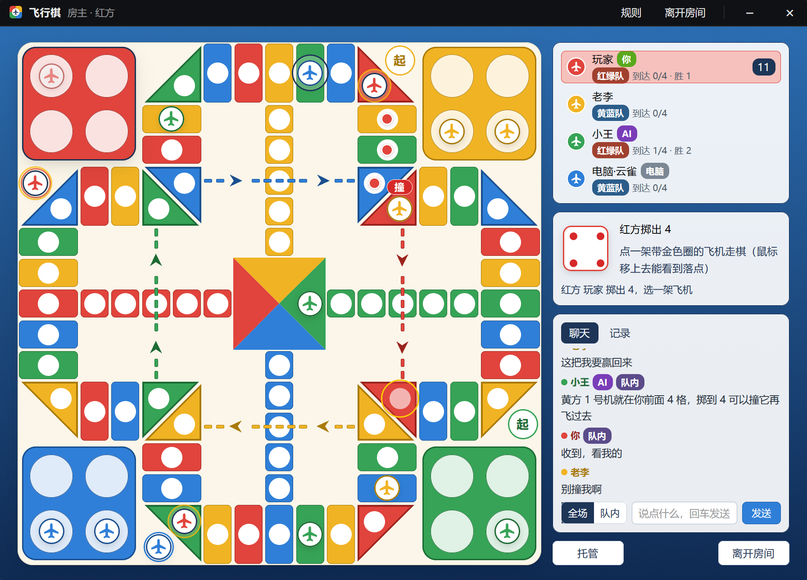

# 飞行棋（Herdr mod）



一个给 [Herdr](https://herdr.dev) 用的局域网飞行棋 mod：红黄绿蓝四方，个人赛（2～4 人）或 2v2 组队，人不够可以加电脑，
牌桌上能聊天（全场 / 队内），也可以让 Claude Code 之类的 AI 通过 MCP 替你下、跟大家聊。不绑定布局，任何布局里都能打开。

**需要装 node**：房主的机器跑服务器，每个玩家的机器跑一个小客户端（都在 herdr-core 的后台终端里）。

## 安装 / 更新

```powershell
node install.mjs            # 装到 Herdr 主目录的 mods/fxq
node install.mjs --update   # 覆盖已安装的版本（旧版备份到 <home>/fxq-backup-<时间>/）
```

默认装到 `HERDR_APP_HOME`，未设置时为 `~/.config/herdr-app`；也可以把目录作为第一个参数传入。

## 打开

- 任何布局里：`herdr-app do mod.open --name fxq`（再执行一次是隐藏）。
- 想要个固定入口：在自己的布局里放一个状态栏按钮（官方布局是只读的，先 `layout.clone` 一份）：

  ```json
  { "id": "fxq", "type": "block", "size": { "px": 34 }, "content": { "mod": "fxq", "props": { "role": "launcher", "block": "fxq" } } }
  ```

  按钮平时只显示图标；在房间里会显示房间人数或对局进度，轮到你而窗口没开时会闪烁提醒。
  `block` 填这个格子自己的 id 时，按钮会用 `layout.resize` 自己调宽度（只有图标 34px，有文字 168px），
  几个这样的按钮可以并排放而不留空隙；不填就用布局里写的宽度。
- 也可以作为一个标签页：`herdr-app do tab.new --mod fxq`。

## 玩法

- **开房**：选「个人赛」或「2v2 组队」，再选「掷出 6 起飞」或「掷出 5、6 都能起飞」，填房间密码（不填会自动生成 6 位），点「创建房间」。
  首次开房时 Windows 防火墙可能会询问 node，选允许（专用网络）。
- **加入**：窗口打开时会自动搜索局域网（UDP 广播，端口 17788），点一下房间再输入密码就能加入；
  也可以手动输入地址（`IP` 或 `IP:端口`，默认 17787）。
- **加密**：对局数据都用房间密码派生的密钥做 AES-256-CTR 加密，带 HMAC-SHA256 校验；密码不对的连接会被拒绝。
  局域网发现的应答是明文，但里面只有房主名、人数和阶段。
- **棋盘**：传统飞行棋的样式（按 17 × 17 小格排）。机场（4 × 4）在四个角（红左上、黄右上、绿右下、蓝左下）。52 格环道是两小格宽的车道：
  每条边中间 5 个长方形格，两端各是一个沿对角线切开的大方块的一半（斜三角，另一半空着或是起飞点）；再贴着机场内侧走 2 格，
  机场内角是一个切成两个三角形的大方块（各算一格），再走 2 格出去。每色的终点跑道（5 格）从自己那条边的正中间直插中心。
- **动画**：掷骰子时骰子翻滚约 0.9 秒（侧栏和棋盘中央各一颗，中央那颗停下后淡出）；飞机一格一格走过去，起飞、跳格和飞行时整段滑过去；撞到对手时落点炸开一圈冲击波、冒出「撞！」，被撞的飞机再慢慢飞回机场。
  电脑会等骰子停下、动画放完再走下一步。轮到你选飞机时，能走的飞机有一圈缓慢明暗的金色圈，不能走的变淡；
  鼠标移上去能看到要走的路径（每一格一个点）、落点，和会撞到人的地方（「撞」）。
- **2v2 组队**：红绿队对黄蓝队，对面坐的是队友。队友之间不会互撞；先到齐的人之后不再掷骰；本队 8 架飞机全部到达就赢。
  开局前可以点空座位「坐这里」，房主可以用「换位」调整座位（也就是选队友）。2v2 要坐满 4 人，人不够加电脑。
- **聊天**：房间里和对局中都能聊，侧栏「聊天 / 记录」切换，有未读数。可以选发「全场」或「队内」（只有队友能看到），回车发送。
  AI 代下时发的消息带「AI」标记。
- **规则**：
  - 掷出 6（或 5、6）起飞，飞机先停到机场旁边标「起」的起飞点（不会被撞），下一步再上环道；顺时针绕一圈，从自己颜色那条边的正中间拐进终点跑道。
  - 停在本色格子：跳到前面下一个本色格子（+4）。
  - 停在本色飞行格（机场内角大方块里的本色三角，有虚线连着）：沿虚线飞越对面那家的终点跑道，到下一个内角的本色三角（+12）。
    跳到飞行格上可以接着飞；飞完这一步就结束。
  - 停在对手所在的格子：把对手撞回机场；终点跑道里是安全的。
  - 进终点要正好点数，多的倒退；掷出 6 走完再掷一次，连续三个 6 本回合作废。
  - 先让四架飞机全部到达终点的获胜，其他人按到达数和进度排名。
- **托管和超时**：每一步（掷骰子或选飞机）20 秒，超时由电脑代走一次，连续超时两次自动托管；随时可以点「托管 / 取消托管」。
  只有一架飞机能走时会自动走。中途掉线也由电脑代下，用同一个名字回来就能接着下。

## 让 AI 替你下

`mods/fxq/mcp.mjs` 是一个 MCP 服务器，让 AI 接管**你自己的座位**，你在 Herdr 的窗口里看着它下：

```
claude mcp add fxq -- node "<Herdr 主目录>/mods/fxq/mcp.mjs"
```

房间面板里有现成的命令（可一键复制）。然后新开一个 Claude Code 会话，对它说「替我下飞行棋」。
它会循环 `fxq_wait`，轮到它就 `fxq_roll`、看每架飞机的走法（落点、会不会撞人、走完的危险度、电脑的建议）再 `fxq_move`，
一局结束后 `fxq_again`。它也能聊天：`fxq_chat` 发全场或队内；有人发新消息时 `fxq_wait` 会醒来（包括你在自己窗口里打的字），
所以你可以在聊天里直接跟替你下棋的 AI 说话，2v2 时它会跟队友商量。AI 代下时每一步有 120 秒；退出那个 Claude Code 会话，座位就还给你。

## 结构

插件本身不碰网络：联网、加密和局域网发现都在 `client.mjs` 这个 node 小进程里（后台终端 `fxq-client`），
插件用 `hc send` 给它发命令，再读它写出的 `data/fxq/state.json`。所以插件重载、关掉或隐藏游戏窗口都不会掉线。

| 文件 | 作用 |
|---|---|
| `mods/fxq/rules.js` | 棋盘几何、走法（起飞、跳、飞、撞、倒退）、电脑的选择、排名 |
| `mods/fxq/server.mjs` | 牌桌服务器（TCP 17787，局域网发现 UDP 17788），掷骰子和规则都在这里 |
| `mods/fxq/client.mjs` | 游戏窗口的连接；AI 通过它本机的控制端口接管座位 |
| `mods/fxq/mcp.mjs` | MCP 服务器（stdio） |
| `mods/fxq/aes.js` | 纯 JS 的 AES-256-CTR + HMAC-SHA256 |
| `mods/fxq/net.js` | 插件这边：启动 fxq-client / fxq-server，跟随状态文件 |
| `mods/fxq/table.js` | 游戏窗口（大厅、房间、棋盘） |
| `mods/fxq/launcher.js` | 状态栏按钮 |

测试（不需要 Herdr）：

```
node tests/rules.mjs    # 棋盘几何、走法，300 局电脑对局
node tests/server.mjs   # 服务器：局域网发现、错误密码、3 局（含托管）
node tests/client.mjs   # 客户端：按插件的方式驱动
node tests/mcp.mjs      # AI 通过 MCP 聊天、下完一整局
node tests/team.mjs     # 2v2：换座、队内/全场聊天、一整局（队友不互撞、整队获胜）
```

`server.mjs` 的第三个参数 `--fast` 让电脑不停顿（测试用）。
