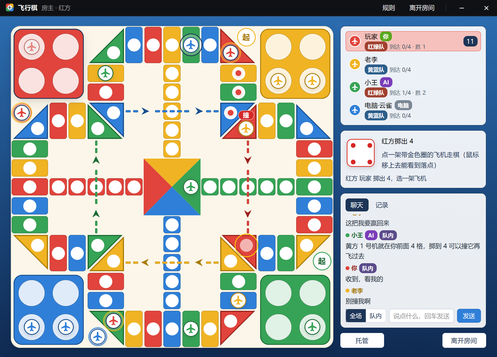

# 飞行棋

A LAN 飞行棋 (aeroplane chess) game window for any Herdr layout: four colors (红 黄 绿 蓝), everyone for themselves (two to four players) or 2v2, computer players to fill in, table chat (to everyone or your team), and an AI that can take over your seat through MCP, and chat, while you watch. UI text is Simplified Chinese.

## What you see

- **Window** (1000 × 720, `frame: "none"`, radius 10, theme border, `shadow_lg`): a 34 px title bar in the layout's theme (`chrome`, `border`, `foreground`, `muted`) with the 18 px four-color icon, 飞行棋, where you sit (房主 · 红方, or 红方 · 已连接 addr), and flat buttons 规则, 离开房间 (in a room), – (hide) and × (hover `#c42b1c`). Below, a sky-blue table (gradient `#2b6cb0 → #0f2a52`). As a pane (`tab.new {mod: "fxq"}`) the same, without – and ×.
- **Lobby** (no table): a 560 px white card: 局域网飞行棋 with the 48 px icon; 创建房间 with two toggles (掷出 6 起飞 / 掷出 5、6 都能起飞), 房间密码 (blank = generated), 创建房间; 加入房间 with the rooms found on the LAN (name, players/4, phase, address), 刷新, an address field, a password field and 加入; errors in `#c42b1c`.
- **Room** (phase lobby): a 600 px card: the four colored seats (a plane chip in the color, the avatar, the name, pills 房主 / 你 / 电脑 / AI, wins, 移除 for the host's computer players), the password and the LAN addresses for the host, the MCP command with 复制命令, the host's takeoff toggles, 添加电脑, 开始游戏 (2+ players), 离开房间, and a note on hide vs ×.
- **Board** (square, 17 grid units; the unit fits the window: `min(width − 336, height − 58) / 17`, the window size divided by the zoom): cream `#fbf6e9`, radius 0.5u, `shadow_lg`.
  - Hangars: the four 4 × 4 corners (红 top left, 黄 top right, 绿 bottom right, 蓝 bottom left), solid main color with a dark border, four white parking spots each. The hangar whose turn it is gets a navy border and a shadow.
  - The ring: 52 squares around the hangars in a lane 2 cells wide, clockwise. Along each side: a 2 × 2 square cut on the diagonal (the half toward the middle is a square; the half toward the corner is empty, or the takeoff pad of the hangar beside it), 5 squares of 1 × 2, and another cut 2 × 2. Then in along a hangar's side (2 squares of 2 × 1), its inner corner (a 2 × 2 square cut into two triangles, a square each), and out along its other side (2 squares). One quarter is laid out; the rest are it turned. Every square is solid main color with a dark edge and a white spot (0.68u; a triangle's at its centroid); the colors take turns (`(k + 2) % 4`), so each color's turn-off and flight squares are its own. Flight squares are the inner-corner triangles where a flight line starts; nothing else marks them.
  - Takeoff pads: a white disc with a color rim and 起, in the empty half next to each hangar.
  - Home columns: 5 squares (1 × 1) like the ring's from the middle of each side (红 left, 黄 top, 绿 right, 蓝 bottom) to the 3 × 3 center, drawn as four triangles meeting in the middle (`paint_path`).
  - Flight lines: dark dots straight across each arm, over the third square of that arm's home column, from one inner-corner triangle of the color diagonally opposite to the same color's triangle at the next corner, 12 steps on; both ends sit level, so the line is straight.
  - Planes: 0.84u white circles with a dark border of the color and a plane in the color, one element per plane (`id pl-<color>-<n>`) with `transition` on left and top; planes sharing a spot stack (0.08u apart) with a count badge. Your movable planes get a gold ring (`#ffb800`) slowly brightening and dimming (`loop opacity`, 1600 ms), your other planes fade to 60 %; hovering one shows its way (a dot on every square it passes), where it lands (a yellow ring), and a red 撞 tag over each square where it would send someone home. The last move's landing spot has a navy ring once the move has been shown.
  - Rolls tumble: the die beside the board and a 2.4u die over the center go through random faces (some drawn a quarter turn round), each a little longer than the last, shaking (`transition` on left/top), for ROLL_MS (900 ms), then show the roll; the big one stays 0.7 s and fades. While it tumbles the card says 掷骰子…. Each roll carries its number (`rollN`).
  - Moves are shown square by square: the plane steps every 300 ms along its path (`walk`), a takeoff, jump or flight is one 650 ms glide. Where it lands on someone: a bump (an orange ring growing from 0.7u to 2.6u and fading, and a red 撞！ rising and fading; the hit plane's rim turns red), then the hit planes fly home (1 s). A window opened mid-game shows the board as it is.
- **Beside the board** (292 px): the players (color chip, name, pills 你 / 电脑 / AI / 托管 / 掉线, 到达 n/4, wins; the one to move highlighted in their light color with the seconds left); the die (56 px, pips on a 3 × 3 grid, 1 and 4 in red, bordered in the roller's color) with who rolled what and what to do now (掷骰子, pick a plane, or waiting for whom); the server's message, an AI banner, errors; 对局记录 (the last 12 lines); 托管 / 取消托管 and 离开房间. When the game is over: the winner, the places, 再来一局.
- **2v2**: seats 红 and 绿 against 黄 and 蓝 (TEAM_OF = seat % 2), 红绿队 / 黄蓝队 tags on seats and players. In the room: 坐这里 on an empty seat (not the host), and for the host 换位 on seats 2–4 (pick one, then 换到这里 on another).
- **Chat**: in the room a 280 × 470 card beside the panel; in a game a 聊天 / 记录 tab card beside the board, with a red unread count. Lines: a color dot, the name (你 for your own), AI and 队内 tags, the text; newest at the bottom. Below: 全场 / 队内 (2v2) and a line to type in (Enter sends) with 发送.
- **Status-bar button** (props `{ role: "launcher", block?: "<its block id>" }`; with `block` it resizes its own block with `layout.resize`, 34 px with the icon alone and 168 px with text, so buttons sit side by side): the 14 px icon at the bar's right end in its colors; with something to say also 房间 n/4, 对局中 · 到达 n/4, AI 代下中, 本局结束 / 你赢了, or 轮到你掷骰子 / 轮到你走棋 in `blocked`.

## How it behaves

- A plane's progress counts steps from its start square: −1 hangar, 0 the takeoff pad (off the ring, safe), 1–50 the ring, 51–55 its home column (safe), 56 home. A 6 (or 5/6) takes off onto the pad. Stopping on your own color jumps 4; stopping on your flight square (progress 18) flies straight across the opposite color's arm, over its home column, to 30. A jump can land on the flight square and fly on; a flight ends the move. Every square a move stops on sends opponents there back to their hangars. Home takes the exact count; the rest walks back out. A 6 rolls again; a third 6 in a row loses the turn. First with all four home wins; the rest rank by planes home, then progress.
- 2v2: teammates never send each other home (captures, danger and the computer's choices know teams); a player with all four home sits out; the first team with all eight home wins, both players get the win, and the team ranks first.
- Chat: up to 200 characters, six lines per 5 s per seat; 队内 lines go to the team only. The server keeps the last 60 and sends each seat the 40 it may see.
- 20 s per roll or pick (120 s for an AI-played seat); a timeout plays that step by computer, two in a row turn on 托管. A single possible move (every movable plane going the same way) moves itself after 0.65 s, except for an AI-played seat. Computer seats roll after 0.55–0.85 s and move after 0.45–0.65 s. A dropped player is played by computer until they return under the same name.
- The status-bar button toggles the window (`mod.open fxq`). – hides it (the seat stays); × leaves the room (and stops the server when hosting), then closes. When it's your turn and the window isn't open, the button's text blinks.
- Agent statuses don't apply; the mod shows no agents.

## Built from

- `mods/fxq/mod.json`: `{ "place": "none", "title": "飞行棋", "overlay": { "kind": "window", "frame": "none", "key": "fxq", "width": 1000, "height": 720 } }`. `main.js` picks the role: `launcher` → `launcher.js`, otherwise `table.js`.
- `rules.js`: the board (`GRID`, `RING` of `{ x, y, w, h, half }`, `ringSpot`, `PAD`, `homeCell`, `CENTER`, `HOME_SPOT`, `HANGAR`, `hangarSpot`, `posOf`), the colors (`squareColor`, `HEX`), moves (`step`, `captures` with where each happened, `options`, `apply`, `walk`, `walkMs`), `danger`, `botChoose`, `ranking`. Shared by the server, the window and the MCP server.
- `server.mjs` (node, TCP 17787, UDP discovery 17788 answering `herdr-fxq?` with `{ t: "fxq-room", port, name, players, phase }`): the authoritative table. Messages, sealed per line with the room password: `hello ctl config (takeoff, mode) bot kick seat swap start again roll move chat auto ai bye` in, `state error ping` out. A socket's seat is looked up live, since seats move before a game. Each move carries its number (`last.n`) so windows know to show it; the computer waits for the die (ROLL_MS) and `walkMs` of the last move before its next step. `--fast` drops the computer's pauses (tests).
- `aes.js`: pure-JS AES-256-CTR + HMAC-SHA256, keys from `herdr-fxq-enc:` / `herdr-fxq-mac:` + password.
- `client.mjs` (node, terminal `fxq-client`): the window's connection. JSON commands on stdin (`_join _leave _scan`, the rest forwarded), the view written atomically to `data/fxq/state.json`, a 127.0.0.1 control port for `mcp.mjs` (token in the state file; while one is connected the seat is AI-played). Chat lines from the control port are marked ai, from the window not.
- `net.js`: each copy (window, button) follows the state file with `watchFolder` (`start(cx, ready, changed)`: `changed` runs before each redraw, where the window starts showing a new move); commands go out with `hc send fxq-client`; hosting starts `hc run --bg --no-parent --rm --name fxq-server -- node server.mjs 17787 <password>`. Shared `fxq.hosting`, `fxq.open`.
- `mcp.mjs` (stdio MCP): `fxq_state fxq_wait fxq_chat fxq_roll fxq_move fxq_rooms fxq_join fxq_add_bot fxq_start fxq_again fxq_auto`; options described in words with `danger_after` and the computer's suggestion; the team, the teammate and the last 10 chat lines. `fxq_wait` also wakes (woke: chat, with new_chat) when anyone but the AI itself speaks, its owner typing in the window included.
- `herdr` calls: `props`, `shared`, `setShared`, `hc`, `exec` (PowerShell `Set-Clipboard` for 复制命令), `appHome`, `home`, `readTextFile`, `watchFolder`, `theme`, `settings`, `closeOverlay`, `run("mod.open")`.
- Art: `icons/fxq.svg` (four-color square, white disc, navy plane), `icons/plane.svg` (one-color, tinted), `icons/user.svg`, `icons/computer.svg`.

## Watch out

- Never open sockets in the mod runtime: a stuck connect takes every mod down. All networking is in the node processes.
- `on_size_change` reports window pixels; element sizes are multiplied by the zoom. Divide by `settings().zoom` before fitting the board, or it overflows at zoom > 1.
- The mod's `crypto.createHash().update()` hashes a Uint8Array as nothing; `aes.js` checks which form works.
- Ring index k's color is `(k + 3) % 4` so each start square (5 + 13c) is its own color; a flight square is repainted its owner's color, which takes one square from the opposite color, so each still owns 13.
- A plane can roll a no-op (from 53 a 6 goes 3 in and 3 back out): it's a legal move.
- `herdr-app check` renders only the lobby; check the board by giving a copy a `net.js` whose `Link.view()` returns a mid-game state.
- Needs node on every player's machine; Windows Firewall asks about node the first time a room opens.

## Done when

- `herdr-app check mods/fxq` passes, and so does a copy forced to `role: "launcher"`.
- `node tests/rules.mjs`, `tests/server.mjs`, `tests/client.mjs` and `tests/mcp.mjs` pass.
- `herdr-app do mod.open --name fxq` opens the lobby and lists rooms on the LAN; 创建房间, 添加电脑 ×3 and 开始游戏 start a game whose board fits the window; rolling and clicking a bouncing plane walks it there square by square; a whole game ends with a winner and 再来一局.
- With the MCP server added to Claude Code, 「替我下飞行棋」 plays your seat to the end of a game while the window shows the AI banner.
